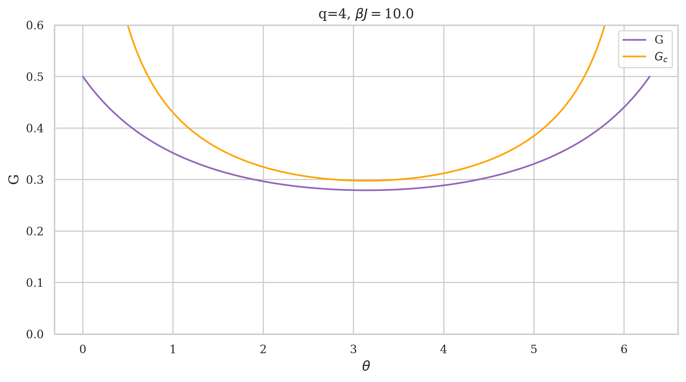
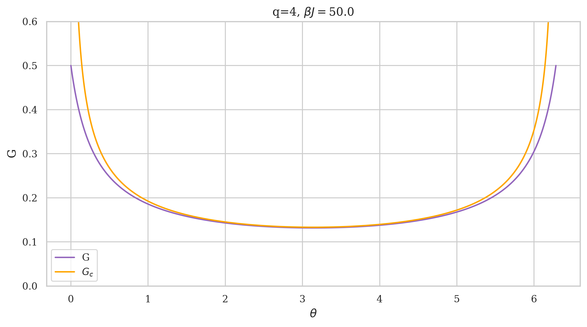
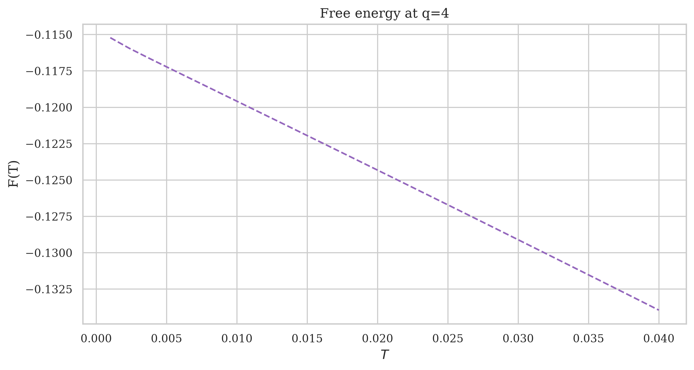
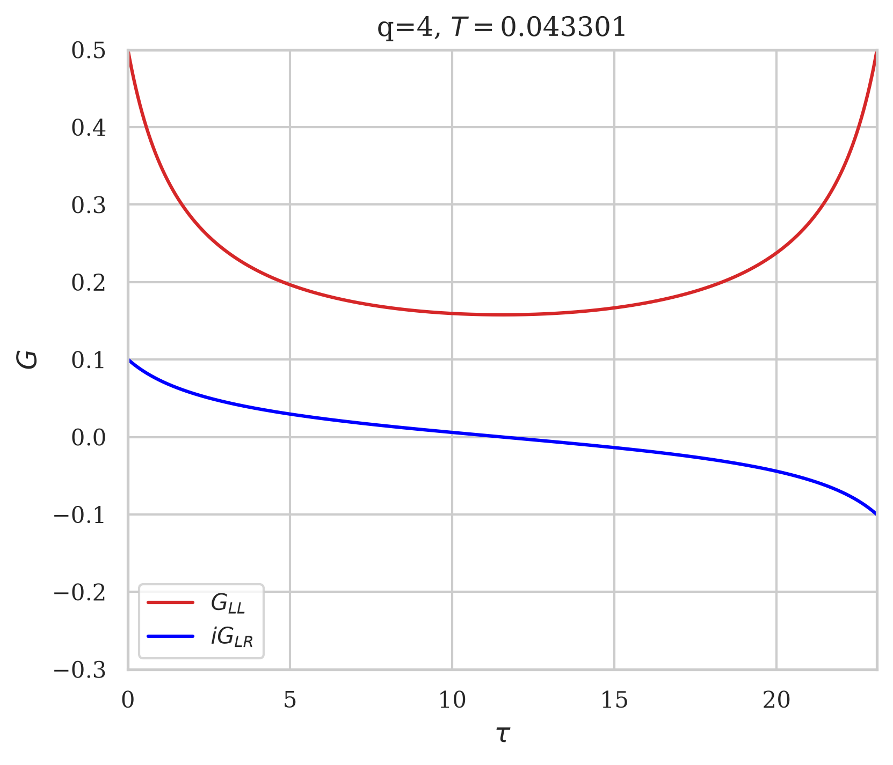
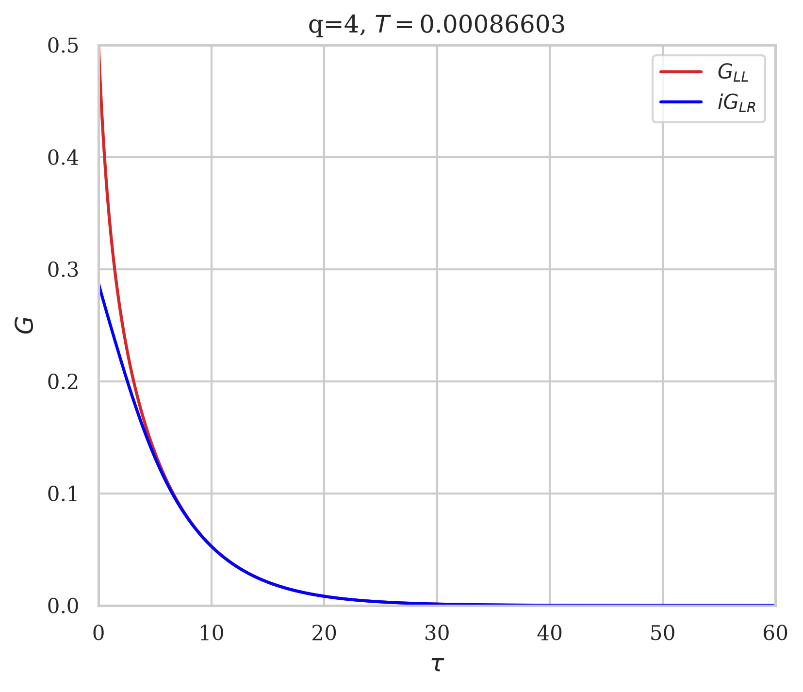
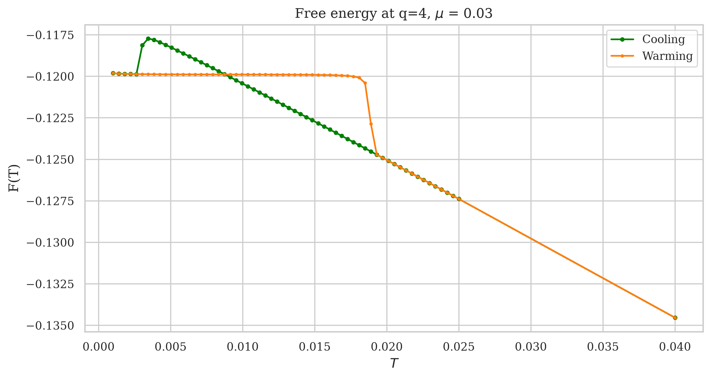
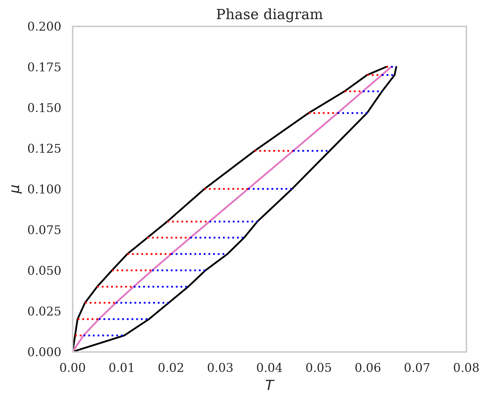

# Maldacena-Qi model

In this project I developed a numerical solver for the large-N Schwinger-Dyson equations of SYK and Maldacena-Qi models. The latter is obtained with two SYK models interacting. 

I used the solvers to compute the large-N Free energy through saddle-point solutions as a function of the temperature.

All the code is based on GPU acceleration, achieved through CuPy library and it has been tested on Nvidia RTX 5070.

## Notebooks

### 1. SYK SD solver and Free Energy computation

**File:** [SYK_SD.ipynb](SYK_SD.ipynb)

Numerical solver for large-N Schwinger-Dyson equations of SYK model.

  
  

**File:** [Free_energy_SYK.ipynb](Free_energy_SYK.ipynb)

Computation of Free Energy as a function of the temperature.

  

**References:** J. Maldacena, D. Stanford. *Comments on the Sachdev-Ye-Kitaev model* (2016): [arXiv:1604.07818](https://arxiv.org/abs/1604.07818)

### 2. MQ SD solver and Free Energy computation
**File:** [SYK_SD.ipynb](SYK_SD.ipynb)

Numerical solver for large-N Schwinger-Dyson equations of MQ model. This is based on the SYK one.

  
  

**File:** [Free_energy_MQ.ipynb](Free_energy_MQ.ipynb)

Computation of Free Energy as a function of the temperature and characterization of first order phase transition between two black holes phase and wormhole phase.

  

I used the notebook to collect data points and plot the Phase Diagram in $mu - T$ plane.

  

**References:** J. Maldacena, X.-L. Qi. *Eternal traversable wormhole* (2018): [arXiv:1804.00491](https://arxiv.org/abs/1804.00491)

## Dependencies
Python, NumPy, CuPy, Matplotlib

